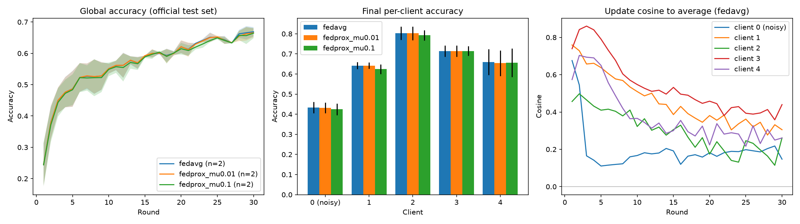
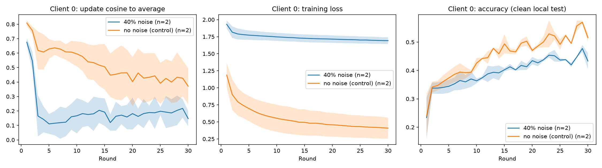

# FedAvg vs FedProx on PathMNIST with a noisy client

Federated learning experiment: 5 clients, non-IID Dirichlet split (alpha = 0.3), and 40% label noise on one client. Compares FedAvg and FedProx (mu = 0.01 and 0.1) and logs everything to Weights & Biases.

- **W&B project (public):** https://forge.coreweave.com/wandb/lj_weighter-f/fl-pathmnist
- **Code:** this repository

## Summary of findings

All numbers are averages over the last 5 rounds (rounds 26 to 30), then mean over 2 seeds.

| Setting | Global acc (official test) | Client 0 acc | Client 0 train loss | Client 0 update cosine | Client 0 update norm |
|---|---|---|---|---|---|
| FedAvg (40% noise on client 0) | 0.655 ± 0.012 | 0.443 | 1.70 | 0.19 | 0.42 |
| FedProx, mu = 0.01 | 0.652 ± 0.013 | 0.440 | 1.70 | 0.19 | 0.42 |
| FedProx, mu = 0.1 | 0.651 ± 0.014 | 0.436 | 1.70 | 0.18 | 0.39 |
| FedAvg, no noise (control) | 0.670 ± 0.004 | 0.532 | 0.42 | 0.41 | 0.31 |

Per-client accuracy of the global model on each client's clean local test set (same averaging):

| Setting | Client 0 (noisy) | Client 1 | Client 2 | Client 3 | Client 4 |
|---|---|---|---|---|---|
| FedAvg | 0.443 | 0.651 | 0.775 | 0.688 | 0.648 |
| FedProx mu = 0.01 | 0.440 | 0.648 | 0.775 | 0.688 | 0.647 |
| FedProx mu = 0.1 | 0.436 | 0.631 | 0.775 | 0.689 | 0.650 |
| FedAvg, no noise | 0.532 | 0.613 | 0.769 | 0.691 | 0.707 |

(± is the standard deviation over only 2 seeds, so it is a rough guide, not a confidence interval.)





**What the results show**

1. **FedAvg and FedProx are practically indistinguishable here.** Global accuracy differs by about 0.003 to 0.004 between algorithms, while two seeds differ by more than that. With this setup (1 local epoch, lr 0.01), clients probably do not drift far from the global model, so the proximal term has little to correct. I would not claim FedProx helps or hurts.
2. **The noise clearly affects the noisy client.** Compared with the no-noise control, client 0 has about 4 times higher training loss (it cannot fit random labels), less than half the update cosine, a larger update norm, and about 0.09 lower accuracy.
3. **The effect on the global model is small.** Global accuracy is about 0.015 lower with noise, which is about the size of the seed-to-seed spread, so with 2 seeds this is not a firm effect.
4. **Client 0 is weak even without noise** (0.53 vs 0.61 to 0.77 for the others), so part of its low accuracy comes from its class mix and not from the noise. This is why the no-noise control matters.
5. **Update cosine and training loss as noise signals.** Client 0's update cosine to the averaged update drops sharply in the first rounds and stays low, and its training loss stays high. Training loss separates the noisy and clean setting very clearly. Cosine helps, but it is not unique to noise: in one no-noise seed, client 4 (a small client) also had a low cosine.

## What I implemented

This is a **standalone implementation written from scratch in PyTorch. It does not use any PFLlib code.** I followed the ideas of PFLlib (FedAvg, FedProx as FedAvg plus a proximal term, per-class Dirichlet splitting) but wrote my own compact version so that I could understand every line. Because of this, there are no "changes to PFLlib" to list. Everything is new:

| File | What it does |
|---|---|
| `data.py` | Loads PathMNIST (`medmnist`), Dirichlet split, local 80/20 train/test split per client, symmetric label noise |
| `model.py` | Small CNN (2 conv + 2 linear layers, no BatchNorm) |
| `fl.py` | Local training (FedAvg / FedProx), evaluation, one communication round, update norm and cosine |
| `main.py` | Command-line entry point, W&B logging, CSV saving |
| `plot.py` | Makes `results/summary.png`, `results/noise_control.png` and prints the summary table |

## Setup

- **Data:** PathMNIST, 28x28 RGB, 9 tissue classes. Only the original **train split** is used for clients. The **official test split** is used for global evaluation. The official test set comes from a different clinical center than the training data, so global accuracy includes a domain shift. The original validation split is not used.
- **Split:** for each class, a Dirichlet(0.3) draw over the 5 clients decides how many of that class's images each client gets. Re-sampled until every client has at least 50 samples.
- **Local test sets:** each client keeps a random 20% of its data as a local test set. The other 80% is its training data.
- **Label noise:** applied after the split, to client 0's **training** labels only. 40% of them are replaced by a different, uniformly random class (symmetric noise). Client 0's local test labels stay clean.
- **Model:** CNN with conv(3,32) - pool - conv(32,64) - pool - linear(3136,128) - linear(128,9), about 422k parameters, no BatchNorm.
- **Training:** SGD (no momentum), lr 0.01, batch size 64, 1 local epoch, 30 rounds, all 5 clients every round.
- **Aggregation:** weighted average of client updates, with weights proportional to each client's number of training samples.
- **FedProx:** adds `(mu/2) * ||w - w_global||^2` to the local loss, where `w_global` is the frozen global model at the start of the round. FedAvg is the same code with mu = 0. Logged training loss is the plain cross-entropy without this term.
- **Seeds:** 0 and 1. The seed controls the Dirichlet split, the noise, the model initialisation and the data shuffling. For a given seed, FedAvg and FedProx use the same split, noise and starting model, so they are compared on identical data.
- **Runs:** `fedavg_seed{0,1}`, `fedprox_mu0.01_seed{0,1}`, `fedprox_mu0.1_seed{0,1}`, plus a control without noise: `fedavg_noise0.0_seed{0,1}`. The control was not required by the task. I added it to separate the effect of noise from the effect of client 0's class mix.

## What is logged (every round)

To W&B and to `results/<run name>.csv`:

- `global_acc`, `global_loss`: global model on the official test set
- `client{k}_acc`, `client{k}_loss`: global model on client k's clean local test set
- `client{k}_train_loss`: client k's average local training loss in that round
- `client{k}_update_norm`: L2 norm of client k's update `w_k - w_global`
- `client{k}_cos_to_avg`: cosine similarity between client k's update and the averaged update
- `clients_mean_acc`: mean of the 5 per-client accuracies

## How to reproduce

```bash
pip install -r requirements.txt
wandb login            # if your W&B account is on a custom server, also set WANDB_BASE_URL

python main.py --algo fedavg --seed 0
python main.py --algo fedprox --mu 0.01 --seed 0
python main.py --algo fedprox --mu 0.1 --seed 0
# repeat with --seed 1

# control (no noise)
python main.py --algo fedavg --noise_rate 0 --seed 0

python plot.py
```

`python main.py --quick` runs 2 rounds on a small subset for a CPU test and logs to a separate test project.

The full runs were done on a Google Colab T4 GPU (about 3 minutes per run). GPU runs may not be bit-for-bit reproducible.

## Limitations

- **Only 2 seeds**, so differences smaller than the seed-to-seed spread (including the FedAvg vs FedProx gap) cannot be called real.
- **Only 5 clients**, one noisy client, one noise type (symmetric) and one noise rate.
- **Small local test sets** (about 40 to 170 images per client), so per-client accuracies are noisy.
- **Domain shift:** the official test set is from a different center, so global accuracy is lower than a same-source test set would give.
- Hyperparameters (lr, local epochs) were not tuned. A larger learning rate or more local epochs would increase client drift and could make FedProx matter more.
- The cosine and norm observations are descriptive. I did not test them as a noisy-client detector.